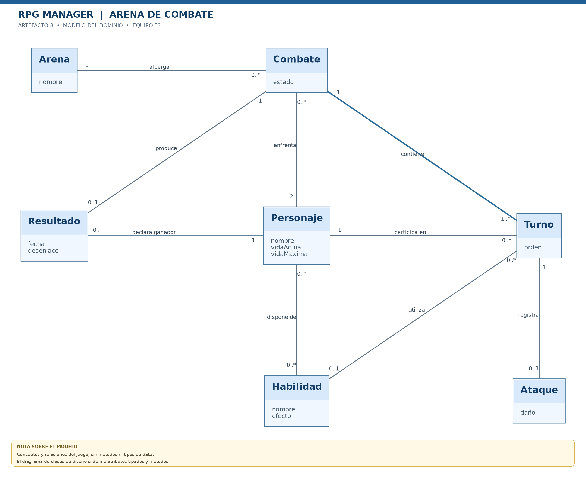

# RPG Manager: modelo del dominio de la arena de combate

**Grupo 3 (E3)**  
**Artefacto 8 de RUP:** Modelo del dominio  
**Fase:** Elaboración, área de análisis  
**Responsable:** Analista de sistemas  
**Herramienta utilizada:** PlantUML

## ¿Qué estamos representando?

En esta parte del proyecto buscamos identificar los elementos que intervienen en un combate y la forma en que se relacionan. La idea es entender cómo funciona la arena de RPG Manager antes de decidir cómo se va a programar.

Por ejemplo, para que exista un combate necesitamos personajes que participen en él. Durante el enfrentamiento se van desarrollando turnos, en los que pueden aparecer ataques o habilidades. Cuando el combate termina, se obtiene un resultado. Esa relación entre los elementos es lo que quisimos mostrar en el diagrama.

El diagrama se puede editar desde el archivo [08_modelo_dominio.puml](08_modelo_dominio.puml).

## Elementos del modelo

La guía pide siete conceptos. En nuestro caso los interpretamos así:

| Concepto | Significado dentro del juego |
|---|---|
| Arena | Lugar donde se lleva a cabo el enfrentamiento. |
| Combate | Encuentro entre dos personajes. Puede estar en curso o haber terminado. |
| Personaje | Participante del combate. Tiene un nombre y una cantidad de vida disponible. |
| Turno | Momento que le corresponde a un personaje para actuar. |
| Ataque | Acción ofensiva que puede realizarse durante un turno. |
| Habilidad | Capacidad que puede usar un personaje; por ejemplo, una acción de defensa. |
| Resultado | Registro de cómo terminó el combate y quién ganó. |

En el diagrama aparecen propiedades como `vidaActual`, `orden` o `desenlace` para reconocer mejor cada concepto. No les asignamos tipos de dato ni agregamos funciones, porque todavía estamos analizando el problema, no diseñando las clases del programa.

## Relaciones entre los elementos

Las líneas del diagrama indican cómo se conectan los conceptos. Los números que aparecen en los extremos se llaman *multiplicidades* y permiten expresar, por ejemplo, si una relación corresponde a uno, a dos o a varios elementos.

Una arena puede albergar varios combates a lo largo del tiempo, pero cada combate se realiza en una sola arena. En el modelo consideramos que cada combate enfrenta a dos personajes; un mismo personaje podría participar en distintos combates. También establecimos que un combate contiene uno o más turnos y que cada turno le corresponde a un personaje.

Durante un turno puede registrarse un ataque o utilizarse una habilidad. Dejamos ambas relaciones como opcionales, ya que no todos los turnos tienen por qué incluir ese tipo de acción. Las habilidades, además, pueden estar disponibles para varios personajes.

Por último, el combate puede producir un resultado. Mientras sigue en curso, ese resultado todavía no existe. Cuando finaliza, el resultado permite identificar al personaje ganador.

Para leer los números del diagrama usamos estas equivalencias:

| Multiplicidad | Qué significa |
|---|---|
| `1` | Exactamente uno. |
| `2` | Exactamente dos. |
| `0..1` | Puede no existir o existir uno. |
| `0..*` | Ninguno, uno o varios. |
| `1..*` | Uno o varios, como mínimo uno. |

Estas son las relaciones que aparecen en el archivo PlantUML:

| Relación | Multiplicidades |
|---|---|
| Arena alberga Combate | Arena `1` — Combate `0..*` |
| Combate enfrenta Personaje | Combate `0..*` — Personaje `2` |
| Combate contiene Turno | Combate `1` — Turno `1..*` |
| Personaje participa en Turno | Personaje `1` — Turno `0..*` |
| Turno registra Ataque | Turno `1` — Ataque `0..1` |
| Personaje dispone de Habilidad | Personaje `0..*` — Habilidad `0..*` |
| Turno utiliza Habilidad | Turno `0..*` — Habilidad `0..1` |
| Combate produce Resultado | Combate `1` — Resultado `0..1` |
| Resultado declara ganador Personaje | Resultado `0..*` — Personaje `1` |

## Relación con las historias de Jira

Tomamos como referencia las historias del backlog de **RPG Manager – Arena de combate**. No todas se convierten en un cuadro del diagrama, porque una historia describe algo que el usuario necesita hacer, mientras que el modelo del dominio reúne los conceptos con los que trabaja el sistema.

- **US02 – Asignar turno inicial:** se relaciona con Combate, Turno y Personaje.
- **US04 – Usar defensa:** nos ayuda a entender por qué se necesita el concepto Habilidad y su relación con los turnos.
- **US05 – Actualizar salud:** se refleja en la vida del Personaje, que puede cambiar durante el enfrentamiento.
- **US06 – Declarar ganador** y **US07 – Registrar resultado:** se relacionan con Resultado y su conexión con Combate y Personaje.
- **US09 – Emparejar oponente:** se relaciona con los dos personajes que participan en un combate.
- **US08 – Otorgar recompensas:** está relacionada con el cierre del combate. Por ahora no añadimos Recompensa como concepto independiente, porque estamos trabajando con los siete conceptos pedidos en la guía.

## ¿En qué se diferencia de un diagrama de clases de diseño?

Aunque los dos pueden parecerse visualmente, no cumplen la misma función. En el **modelo del dominio** describimos los elementos del juego y sus relaciones. Por eso mostramos conceptos como Personaje, Turno y Combate sin entrar en detalles de programación.

En cambio, el **diagrama de clases de diseño** sirve para definir la estructura que se implementará: atributos con tipos de dato, métodos, visibilidad y otros detalles técnicos. Es un paso posterior. En este artefacto nos interesa explicar *qué existe en el juego y cómo se conecta*, no escribir todavía *cómo funcionará el código*.

## Decisiones que debemos confirmar con el equipo

Para completar el diagrama fue necesario asumir algunas reglas que no aparecen detalladas en la guía RUP. Las dejamos identificadas para revisarlas con el Product Owner:

1. El combate es individual: participan exactamente dos personajes, no equipos.
2. Cada turno se asigna a un solo personaje.
3. En un turno se registra como máximo un ataque y se utiliza como máximo una habilidad. El diagrama no determina si se pueden combinar ambas acciones.
4. Al finalizar el combate se declara un único ganador. No se incluyeron empates.
5. Una misma habilidad puede estar disponible para más de un personaje.

Si las reglas definitivas del juego son distintas, habrá que ajustar las relaciones y las multiplicidades. Es mejor corregirlas en esta etapa que encontrar la diferencia cuando ya se esté programando.

## ¿Para qué sirve este trabajo dentro de RUP?

El punto de partida del modelo son el glosario y los requisitos de la arena de combate. A partir de ellos organizamos los conceptos principales del módulo. Este trabajo puede servir como referencia para el diagrama de clases de diseño del Equipo 4 y para el modelo de datos del Equipo 5.

El eslabón de trazabilidad completo del Grupo 3 debe quedar documentado por separado en `00_eslabon_trazabilidad.md`, como lo solicita la guía del taller.
