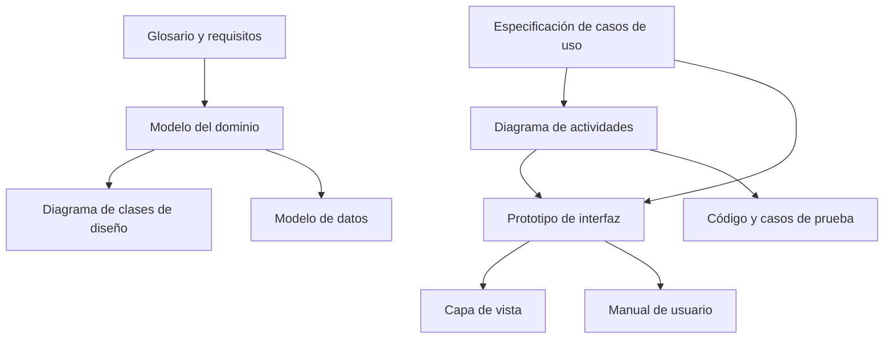

# ⚔️ RPG Manager – Arena de Combate

## Equipo E3 | Análisis de Sistemas – RUP


---

## 1. Información académica

| Información | Descripción |
|---|---|
| Universidad | Universidad Distrital Francisco José de Caldas |
| Facultad | Facultad Tecnológica |
| Programa | Tecnología en Sistematización de Datos |
| Asignatura | Análisis de Sistemas |
| Docente | Francisco Cuéllar |
| Proyecto | RPG Manager |
| Módulo | Arena de combate |
| Equipo | E3 |
| Metodología | Rational Unified Process (RUP) |
| Fase principal | Elaboración |
| Disciplina | Análisis |
| Periodo académico | 2026-2 |

---

## 2. Descripción del proyecto

Este repositorio contiene los artefactos desarrollados por el
Equipo E3 para el taller final de Análisis de Sistemas,
denominado **RUP en acción: los 20 artefactos de RPG Manager**.

El equipo trabaja sobre el módulo **Arena de combate**,
encargado de representar los enfrentamientos entre personajes
mediante un sistema de combate por turnos.

El trabajo se concentra en el análisis conceptual del módulo,
la representación de sus procesos y la definición de las
interfaces mediante las cuales interactúa el jugador.

Estos artefactos fueron elaborados durante la fase de
Elaboración de RUP y sirven como base para las posteriores
actividades de diseño, implementación y pruebas del sistema.

---

## 3. Integrantes del equipo

| Integrante | Rol Scrum | Usuario |
|---|---|---|
| 1. Santiago Chimbi | Dev | SANM_C |
| 2. Juan Sebastian Morales Guzman | Scrum Master | [sebastian-morales10](https://github.com/sebastian-morales10) |
| 3. Cristian Andrés Olivero Garzon | Dev | [Caolivero0925](https://github.com/Caolivero0925) |
| 4. Nicolas Santiago Amaya Pardo | Dev | [NicolasAmaya77](https://github.com/NicolasAmaya77) |
| 5. Juan Nicolas Reyes (20242578031) | Product Owner | [Juanchi-Reyes](https://github.com/Juanchi-Reyes) |

### Roles desempeñados en RUP

Para el desarrollo del taller, el Equipo E3 representa
los siguientes roles de RUP:

- **Analista de sistemas:** responsable del análisis conceptual,
  el modelo del dominio y la representación de los procesos.
- **Diseñador de interfaz:** responsable de diseñar las interfaces
  y representar la interacción del usuario con el sistema.

---

## 4. Objetivos

### Objetivo general

Analizar y representar el funcionamiento del módulo Arena
de combate de RPG Manager mediante la elaboración de
artefactos de la metodología RUP.

### Objetivos específicos

- Identificar los conceptos principales del dominio y sus relaciones.
- Representar el flujo de actividades de un combate por turnos.
- Diseñar las interfaces y la navegación del módulo.
- Establecer la trazabilidad entre requisitos y artefactos.
- Mantener la coherencia conceptual y funcional entre los
  documentos desarrollados.
- Evaluar la comprensión de los artefactos mediante una
  dinámica de preguntas.

---

## 5. Artefactos desarrollados

| N.º | Artefacto | Rol RUP | Herramienta |
|---|---|---|---|
| 08 | Modelo del dominio | Analista de sistemas | PlantUML |
| 09 | Diagrama de actividades | Analista de sistemas | PlantUML |
| 10 | Prototipo de interfaz | Diseñador de interfaz | Google Stitch y PlantUML |

### 5.1. Artefacto 08 – Modelo del dominio

Representa los conceptos principales que intervienen en la
Arena de combate, sus propiedades, asociaciones y
multiplicidades, sin incorporar detalles de implementación.

El modelo contiene siete conceptos principales:

- Arena.
- Combate.
- Personaje.
- Turno.
- Ataque.
- Habilidad.
- Resultado.

Estos conceptos permiten comprender la estructura del módulo
antes de desarrollar las clases de software y el modelo de datos.


**Archivos del artefacto:**

- [Documentación del modelo del dominio](E3-Arena-combate/Artefacto08_Modelo_Dominio/08_modelo_dominio.md)
- [Código fuente PlantUML](E3-Arena-combate/Artefacto08_Modelo_Dominio/08_modelo_dominio.puml)
- [Diagrama exportado](E3-Arena-combate/Artefacto08_Modelo_Dominio/08_modelo_dominio.png)

---

### 5.2. Artefacto 09 – Diagrama de actividades

Representa el flujo de funcionamiento de un combate por
turnos, identificando las acciones realizadas por el jugador
y las responsabilidades del sistema.

El diagrama contempla:

- Selección del rival e inicio del combate.
- Preparación de los personajes.
- Ejecución de ataques y habilidades.
- Evaluación de ataques esquivados.
- Aplicación de daño y actualización de vida.
- Alternancia de turnos.
- Determinación del ganador.
- Registro y visualización del resultado.


**Archivos del artefacto:**

- [Documentación del diagrama de actividades](E3-Arena-combate/Artefacto09_Diagrama_Actividades/diagrama_actividades.md)
- [Código fuente PlantUML](E3-Arena-combate/Artefacto09_Diagrama_Actividades/diagrama_actividades.puml)
- [Diagrama exportado](E3-Arena-combate/Artefacto09_Diagrama_Actividades/diagrama_actividades.png)

---

### 5.3. Artefacto 10 – Prototipo de interfaz

El prototipo representa visualmente la interacción del
jugador con la Arena de combate, permitiendo validar las
interfaces, los componentes gráficos y la navegación antes
de comenzar la implementación del software.

Fue elaborado mediante Google Stitch, utilizando una
identidad visual inspirada en la temática medieval fantástica.

#### P01 – Selección de rival

Permite visualizar las características del personaje propio,
consultar los rivales disponibles e iniciar un combate.


#### P02 – Turno de combate

Permite visualizar el estado de los personajes, sus barras
de vida y maná, el turno activo, las acciones disponibles
y el registro del combate.


#### P03 – Resultado del combate

Presenta el resultado final del enfrentamiento, el personaje
ganador, las estadísticas y las opciones de navegación
posteriores al combate.


#### Diagrama de navegación

Representa las transiciones entre las interfaces y las
condiciones que permiten pasar de una pantalla a otra.


**Archivos del artefacto:**

- [Documentación del prototipo de interfaz](E3-Arena-combate/Artefacto10_Prototipo_interfaz/prototipo_interfaz.md)
- [Código fuente del diagrama de navegación](E3-Arena-combate/Artefacto10_Prototipo_interfaz/navegacion.puml)
- [Diagrama de navegación exportado](E3-Arena-combate/Artefacto10_Prototipo_interfaz/navegacion.png)

---

## 6. Eslabón de trazabilidad

La trazabilidad permite establecer la relación entre los
requisitos del sistema, los artefactos de análisis y los
productos que se desarrollarán posteriormente.

Cada artefacto recibe información de actividades anteriores
y proporciona insumos para las siguientes disciplinas de RUP.



### Documentos de trazabilidad

| Documento | Descripción |
|---|---|
| [Eslabón de trazabilidad](E3-Arena-combate/00_eslabon_trazabilidad.md) | Identifica los insumos, requisitos y artefactos posteriores relacionados con el trabajo del equipo. |
| [Matriz de coherencia](E3-Arena-combate/04_matriz_coherencia.md) | Establece la correspondencia conceptual, terminológica y funcional entre los tres artefactos. |

---

## 7. Presentación y dinámica de preguntas

Como parte de la sustentación del taller, el equipo elaboró
una presentación de los tres artefactos y una actividad
interactiva mediante Kahoot.

La dinámica está compuesta por cuatro preguntas orientadas
a evaluar:

- Comprensión del modelo del dominio.
- Aplicación del diagrama de actividades.
- Utilidad del prototipo de interfaz.
- Identificación de errores en los artefactos.

### Documentos

| Entregable | Archivo |
|---|---|
| Presentación de los artefactos RUP | [Consultar presentación PDF](E3-Arena-combate/Presentacion_Artefactos_RUP_E3.pdf) |
| Preguntas y respuestas del Kahoot | [Consultar dinámica de preguntas PDF](E3-Arena-combate/Preguntas_Kahoot_RUP_E3.pdf) |

---

## 8. Estructura del repositorio

```text
Expo_RUP_Team_3/
│
├── README.md
│
└── E3-Arena-combate/
    │
    ├── 00_eslabon_trazabilidad.md
    ├── 04_matriz_coherencia.md
    │
    ├── Artefacto08_Modelo_Dominio/
    │   ├── 08_modelo_dominio.md
    │   ├── 08_modelo_dominio.png
    │   └── 08_modelo_dominio.puml
    │
    ├── Artefacto09_Diagrama_Actividades/
    │   ├── diagrama_actividades.md
    │   ├── diagrama_actividades.png
    │   └── diagrama_actividades.puml
    │
    ├── Artefacto10_Prototipo_interfaz/
    │   ├── prototipo_interfaz.md
    │   ├── P01_seleccion_rival.png
    │   ├── P02_turno_combate.png
    │   ├── P03_resultado.png
    │   ├── navegacion.png
    │   └── navegacion.puml
    │
    ├── Preguntas_Kahoot_RUP_E3.pdf
    └── Presentacion_Artefactos_RUP_E3.pdf
```

---

## 9. Herramientas utilizadas

| Herramienta | Aplicación en el proyecto |
|---|---|
| PlantUML | Elaboración de diagramas conceptuales, de actividades y navegación. |
| UML | Lenguaje de modelado de los artefactos. |
| Google Stitch | Diseño de los prototipos de interfaz. |
| Markdown | Documentación técnica del proyecto. |
| Git | Control de versiones. |
| GitHub | Repositorio y trabajo colaborativo. |
| Kahoot | Dinámica de evaluación y participación. |
| PDF | Presentación y documentación de los entregables. |

---

## 10. Consulta del repositorio

Para descargar una copia local del proyecto, ejecutar:

```bash
git clone https://github.com/Juanchi-Reyes/Expo_RUP_Team_3.git
```

Ingresar al directorio:

```bash
cd Expo_RUP_Team_3
```

Los archivos `.puml` pueden visualizarse y editarse mediante
PlantUML o utilizando una extensión compatible en Visual
Studio Code.

El repositorio contiene documentación, diagramas y
prototipos de análisis. Por lo tanto, no requiere la
instalación de dependencias ni la ejecución de un servidor.

---

## 11. Estado de los entregables

- [x] Artefacto 08 – Modelo del dominio.
- [x] Artefacto 09 – Diagrama de actividades.
- [x] Artefacto 10 – Prototipo de interfaz.
- [x] Código fuente de los diagramas PlantUML.
- [x] Imágenes exportadas de los diagramas.
- [x] Prototipos de las tres interfaces.
- [x] Diagrama de navegación.
- [x] Eslabón de trazabilidad.
- [x] Matriz de coherencia.
- [x] Presentación de los artefactos.
- [x] Documento de preguntas y respuestas.

---

## 12. Conclusión

El desarrollo de los artefactos del Equipo E3 permite
comprender la estructura conceptual, el comportamiento y
la interacción visual del módulo Arena de combate de
RPG Manager.

La aplicación de RUP facilita la organización del proceso
de análisis y establece una base documental para las
posteriores disciplinas de diseño, construcción y pruebas,
favoreciendo la trazabilidad y la detección temprana
de inconsistencias.

---

<div align="center">

### ⚔️ RPG Manager – Equipo E3

**Universidad Distrital Francisco José de Caldas**

Facultad Tecnológica  
Tecnología en Sistematización de Datos  
Análisis de Sistemas – 2026-2

**Desarrollado con fines académicos.**

</div>